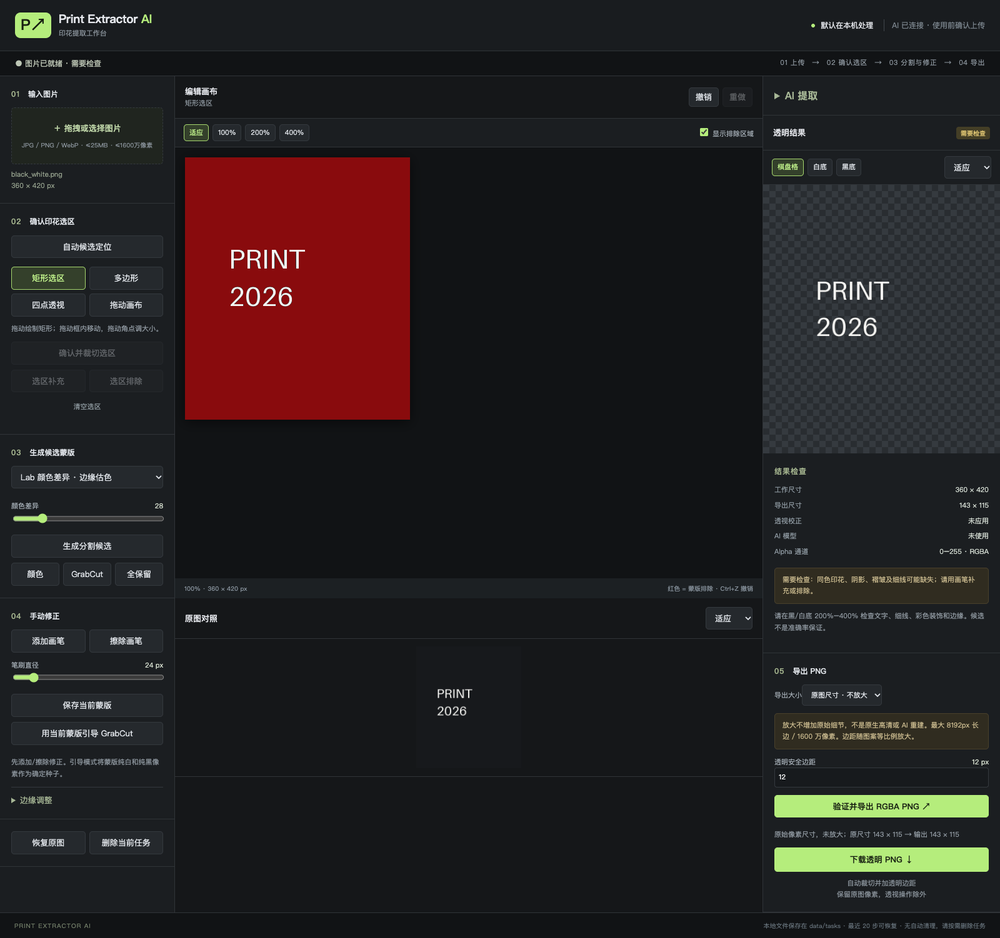
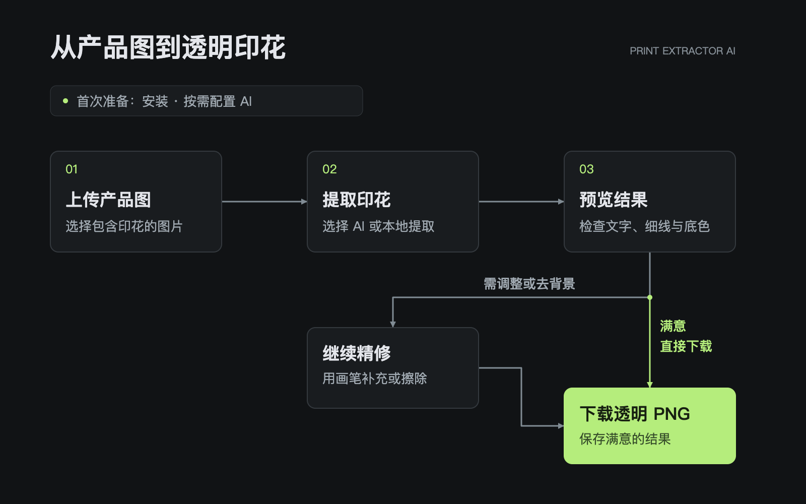

# Print Extractor AI

把商品图里的印花，变成独立的透明 PNG。

上传产品图，用 AI 提取印花，再用画笔调整不满意的细节。原图和生成结果都会保留，完成后直接下载。

**AI 提取 · 原图对照 · 画笔精修 · 透明 PNG 下载**

在自己的电脑上运行，通过浏览器使用。

## 三步完成印花提取

1. **上传图片**：选择产品图，圈住完整印花。
2. **提取与调整**：选择 AI 开始提取；需要时点“继续精修”，用画笔补回遗漏、擦除残留。
3. **检查并下载**：切换黑底、白底检查效果，满意后导出并下载透明 PNG。

AI 生成可能重绘文字和细节，请在下载前对照原图检查。

## 安装到你的电脑

把这段话交给能操作本机的 AI Agent：

请将 https://github.com/zroguan-lab/temukoutu 安装到我的电脑，按仓库实际版本完成环境准备并启动，打开工作台确认可用。Windows 请创建桌面快捷方式，让我以后双击就能打开；服务已运行时直接复用。需要 GPT 登录时，准备好官方 Codex CLI，账号授权和密钥由我填写。最后告诉我日常打开和关闭的方法，若公开版本缺少本文功能，请说明。

当前文档对应本地预览版，尚未发布到 [GitHub](https://github.com/zroguan-lab/temukoutu)。

## 配置你的 AI

打开右侧 **AI 提取 → 配置 AI**，推荐点击“连接 GPT”，在官方页面完成登录和授权。已有登录可点击“检查 GPT 登录”。

也可以跳过 AI 配置，使用本地提取和画笔完成处理，无需账号。效果会大打折扣。

## 模型选择与实测

| **使用方式** | **当前情况** |
| --- | --- |
| **GPT OAuth · 推荐** | 已接入工作台，酒杯和鸭子印花均已实测生成透明 PNG，可直接继续精修。 |
| **Grok OAuth · 暂不推荐** | 已接入工作台；实测透明印花结果较差。 |
| **豆包 Seedream 5.0 Pro API** | 独立 API 实测可生成透明印花，可自行配置 API。 |

欢迎测试其他图像模型并提 [issue](https://github.com/zroguan-lab/temukoutu/issues) 或 PR，分享具体型号和使用效果，请勿附带密钥。

[使用帮助](docs/USER_GUIDE.md) · [安装帮助](docs/SETUP.md)
